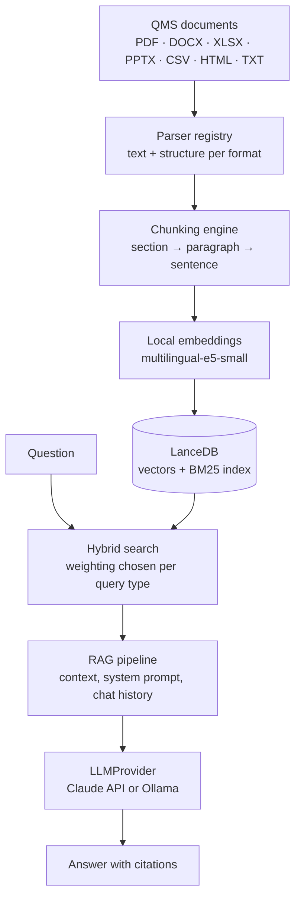

# Document-RAG


**A retrieval-augmented search assistant for document collections such as quality management systems.
Ask a question in plain German and get an answer with citations.
Parsing, embeddings and index stay on your own machine.**

Quality management systems keep their documents as PDF, Word, Excel and PowerPoint files on a
network share, where finding anything means knowing the file name. QMS-RAG parses those
documents, splits them along their headings, indexes them in a local LanceDB with both vector
and BM25 search, and answers questions using the retrieved passages as context. Every answer
names the documents, sections and pages it came from.

Only the handful of retrieved passages is ever sent to a language model — never the document
base. With the Ollama provider, nothing leaves the machine at all.

## Features

- **Natural-language search with citations** across the whole document base, instead of
  file-name guessing. Each answer lists the source documents, their sections and page numbers.
- **Seven document formats**: PDF, DOCX, XLSX, PPTX, CSV, HTML and TXT, each with a parser that
  preserves structure — Word heading styles, Excel sheets, PowerPoint slides and notes,
  PDF headings with their page numbers.
- **Hybrid search that adapts to the question**: free-form questions lean on semantic vector
  search, while document numbers (`VA-0815`), norm references (`ISO 9001`) and quoted phrases
  shift the weighting towards exact BM25 matching.
- **Section-aware chunking**: documents are split at their own headings first, then at
  paragraph and sentence boundaries, with a configurable overlap so no statement is cut in half.
- **Two interchangeable LLM providers** behind one interface: the Anthropic Claude API for
  answer quality, or a local Ollama model for full data sovereignty. Switching is a line in
  `.env`, not a code change.
- **Incremental indexing**: a second run only touches files that changed, so re-indexing a
  share of several hundred documents takes seconds instead of minutes.
- **Local embeddings**: `multilingual-e5-small` runs through sentence-transformers on the CPU,
  so no document text is sent anywhere to be embedded.

## How it works



Retrieval is deterministic Python; the model's only job is to phrase an answer from passages it
was handed. More detail in [docs/ARCHITECTURE.md](docs/ARCHITECTURE.md).

## Design principles

- **The index is local.** Parsing, chunking, embeddings and search all run on the machine that
  holds the documents. Nothing is uploaded to be indexed.
- **Minimal data transfer.** Only the top-ranked passages for the current question reach the
  cloud provider, never whole documents and never the corpus.
- **Provider-agnostic.** Embedding and LLM access sit behind `EmbeddingProvider` and
  `LLMProvider`; `claude_provider` and `ollama_provider` are interchangeable implementations,
  and the pipeline above them does not know which one is active.
- **Answers carry their sources.** The pipeline labels every passage it passes to the model and
  returns the source list alongside the answer, so a claim can be traced back to a document.
- **Degrade, don't crash.** A password-protected PDF, an unreachable document share or a
  missing full-text index is reported and skipped; the rest of the run continues.
- **No surprise dependencies in CI.** The test suite drives the whole pipeline through fakes for
  embeddings and the language model, so it needs no model download, no API key and no network.

## Tech stack

| | |
|---|---|
| Language | Python 3.11+ |
| UI | Streamlit (chat, indexing controls, index status) |
| Embeddings | sentence-transformers, `multilingual-e5-small` (local, 384 dimensions) |
| Index | LanceDB — vector search and Tantivy BM25 in one table |
| LLM | Anthropic Claude API or local Ollama, behind one `LLMProvider` interface |
| Parsing | PyMuPDF, python-docx, openpyxl, python-pptx, stdlib `csv` and `html.parser` |
| Tests | pytest, 144 tests with fakes for every external service |

The code, docstrings and the UI are in German: the documents, the users and the domain
vocabulary of a German QMS are German. This README and the architecture notes are in English.

## Requirements

- Python 3.11 or later
- About 1 GB of disk space — roughly 500 MB for the embedding model plus the index
- A document directory: a local folder or a mounted network share
- For the cloud provider: an Anthropic API key. For the local provider: a running Ollama
  instance. Indexing and search work without either.

## Getting started

```bash
python -m venv .venv
source .venv/bin/activate        # Windows: .venv\Scripts\activate
pip install -r requirements.txt

cp .env.example .env             # Windows: copy .env.example .env
```

Set `DOCS_PATH` in `.env` to your document directory and, if you use the Claude provider,
`ANTHROPIC_API_KEY`. For a fully local setup, set `LLM_PROVIDER=ollama` instead.

```bash
streamlit run app.py
```

Open http://localhost:8501 and click **Indizierung starten**. The first run downloads the
embedding model (about 500 MB) and indexes the document directory; later runs only pick up
what changed.

## Running the tests

```bash
pip install -r requirements-dev.txt
pytest
```

The suite runs in a few seconds. It builds its own PDF, Word, Excel and PowerPoint test files at
runtime, indexes them into a temporary LanceDB, and drives embeddings and the language model
through deterministic fakes — no model download, no API key, no network access.

```bash
ruff check .
```

## Known issues

- No metadata layer yet. Document type, document number and version are not extracted from the
  documents, so metadata filters only work on file name, section title and page number. Query
  analysis already recognises document numbers and norm references and shifts the search
  weighting accordingly.
- Change detection compares file size and modification time, not file content. A document
  restored from a backup is re-indexed unnecessarily; an edit that leaves both unchanged is
  missed. A full re-index (**Komplett neu indizieren**) is the way out.
- Indexing is triggered manually from the sidebar. There is no file watcher that picks up
  changes on the share by itself.
- `stream_query()` streams an answer token by token and is covered by tests, but the Streamlit
  view still calls `query()`, so answers appear in one piece.
- Scanned, image-only PDFs need `pytesseract` and a Tesseract installation. Without them the
  OCR fallback is skipped and such pages contribute no text.
- Retrieval quality has not been measured against a gold-standard question set, so there are no
  recall or precision numbers to quote.

## Project structure

```
app.py                  Streamlit entry point: chat, indexing controls, index status
config.py               all settings, read from environment / .env
core/
  parser/               one parser per format behind a registry (PDF, DOCX, XLSX, PPTX, text)
  chunking/             section-aware chunking with overlap and small-chunk merging
  embeddings/           EmbeddingProvider interface and the local sentence-transformers provider
  search/               LanceDB store (schema, CRUD, FTS) and the hybrid search strategy
  llm/                  LLMProvider interface with Claude and Ollama implementations
  ingestion/            scan → parse → chunk → embed → store, with incremental updates
  rag.py                retrieval, context assembly, QMS system prompt, source extraction
  logging_config.py     rotating log files per category (app, search, ingestion)
tests/                  144 tests with fakes for embeddings and the language model
docs/ARCHITECTURE.md    layers, data flow, chunking and search strategy, privacy
```

## License

[MIT](LICENSE)
